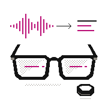
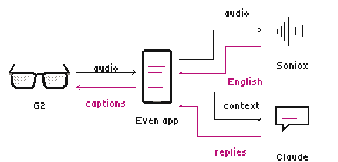

<p align="center">
  
</p>
<h1 align="center">Universal Translator</h1>
<p align="center">Follow the conversation. Find the words.</p>
<p align="center">
  <a href="https://github.com/lejlot/prod-universal-translator/actions/workflows/ci.yml"></a>
</p>
<p align="center"><a href="https://github.com/lejlot/prod-universal-translator/tree/v0.2.11"><strong>v0.2.11</strong></a> · Even Realities G2 · Live translation · Suggested replies</p>

## What it does

- Follow a conversation in English through your glasses.
- Get suggested replies with short English glosses.
- Control the app from your phone and see a live mirror of the glasses display.

<p align="center"></p>

## Get started

1. Install the app package through the Even app. Requires G2 glasses and Even app **2.2.10** or later.
2. Enter your Soniox and Anthropic API keys in Settings, then use **Check** to validate them.
3. Choose the conversation language and microphone. Add a Soniox organization key only if you want to see your prepaid balance.

## Build

Requires **Node.js 24**.

```sh
npm ci
npm run pack
```

Creates `universal-translator.ehpk`. For a browser build and preview:

```sh
npm run build
npm run preview
```

## Privacy & services

Audio is sent to Soniox for speech recognition and translation. Recent conversation text is sent to Anthropic when you request suggested replies. Your API keys are stored by the Even app on your phone. Service accounts and usage charges are separate.

## Checks

[CI](https://github.com/lejlot/prod-universal-translator/actions/workflows/ci.yml) type-checks the app, builds and validates the package, and scans source for secrets on pushes and pull requests.
